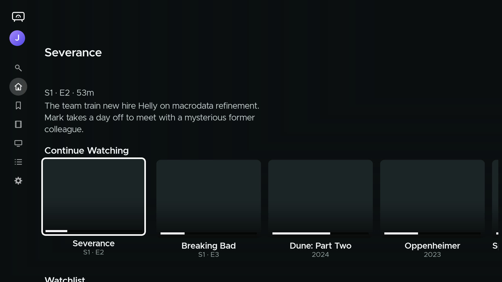
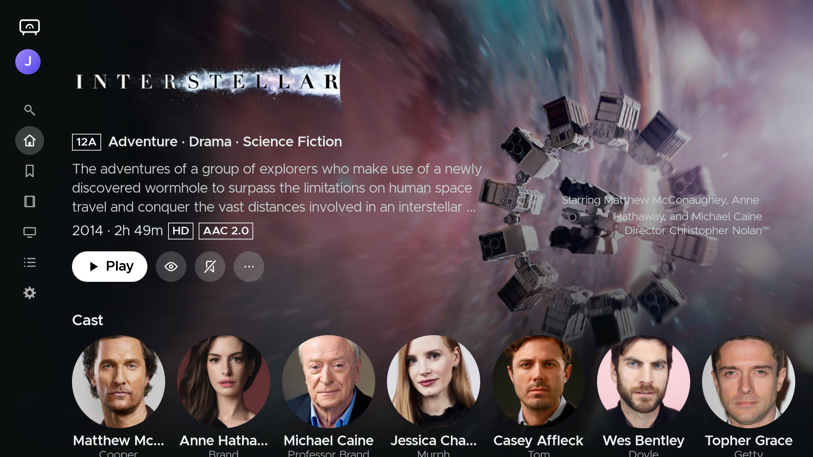
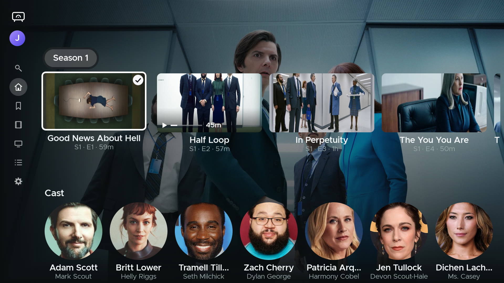
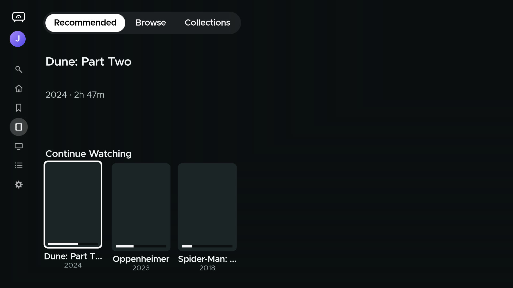
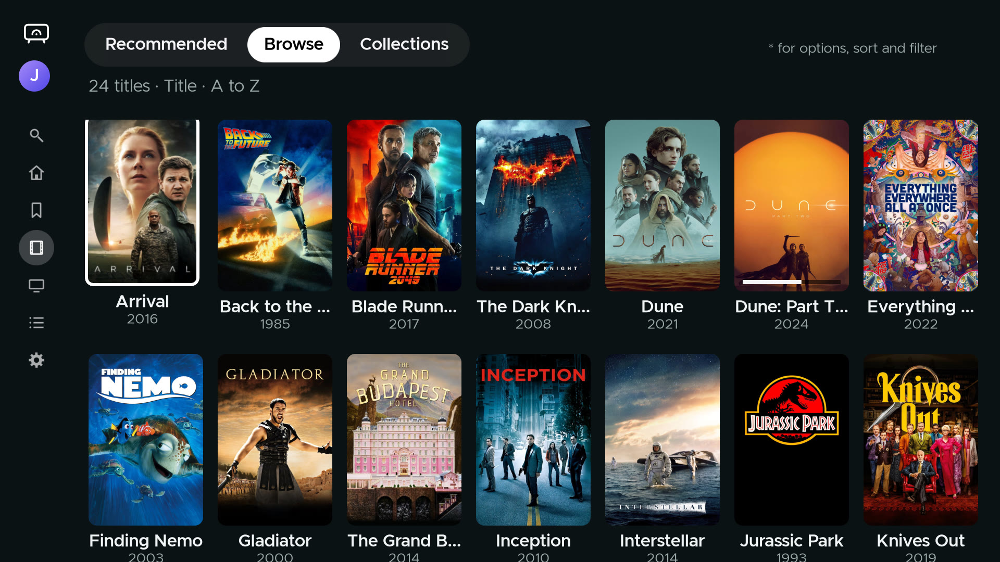
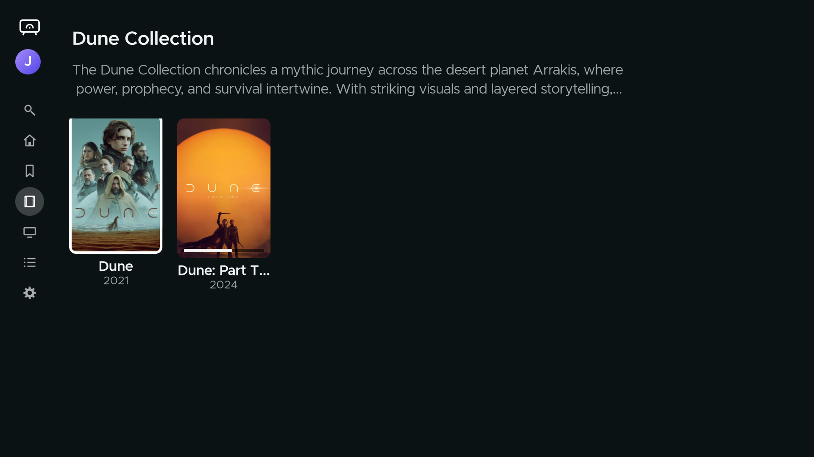
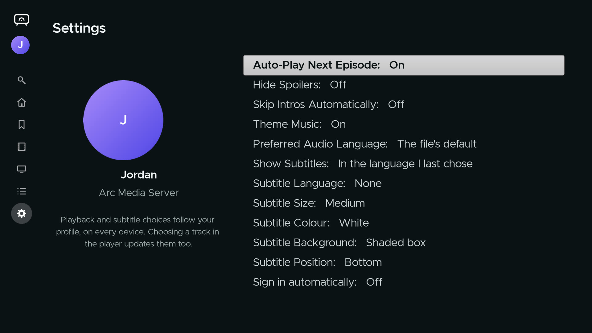
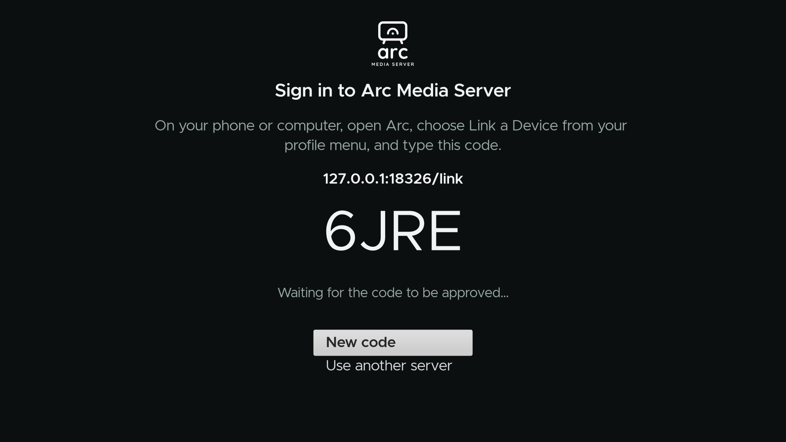
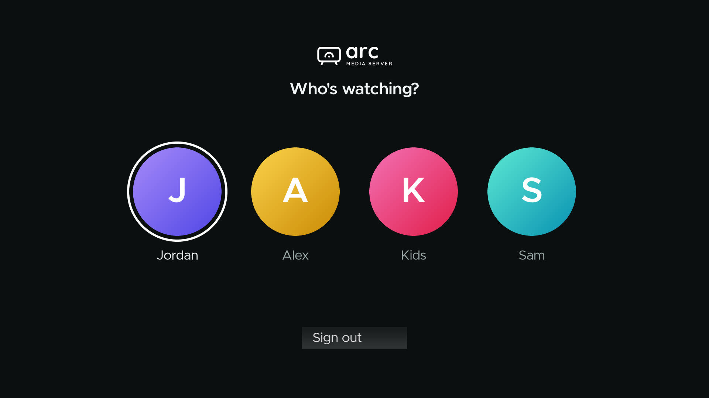

<p align="center">
  <picture>
    <source media="(prefers-color-scheme: dark)" srcset="docs/brand/arc-logo-stacked-white.svg">
    
  </picture>
</p>

<p align="center">
  <strong>Arc for Roku · Your Arc library on Roku OS, made for the remote.</strong>
</p>

<p align="center">
  
  
  
  
</p>

<p align="center">
  
</p>

## What is Arc for Roku?

The Roku app for [Arc Media Server](https://github.com/arc-media-server/arc-media-server).
Bring your self-hosted film and TV library to your Roku. Your watch history and resume points
follow your profile between Arc apps.

> **Alpha software.** Install it in Roku's developer mode. See [what's changed](docs/changes/).

<table>
  <tr>
    <td width="50%"></td>
    <td width="50%"></td>
  </tr>
  <tr>
    <td width="50%"></td>
    <td width="50%"></td>
  </tr>
  <tr>
    <td width="50%"></td>
    <td width="50%"></td>
  </tr>
  <tr>
    <td width="50%"></td>
    <td width="50%"></td>
  </tr>
</table>

<sub>Artwork and details from TMDB. Films and shows belong to their owners; Arc doesn't include any media.</sub>

These captures are from the brs-engine simulator, where fonts may fall back and horizontal buttons may stack vertically.

## What it does

**🏠 Artwork-led Home.** Continue Watching, Up Next and your libraries' rows, with artwork
from the focused title.

**🎬 Title pages.** Play or Resume a film, mark it watched or add it to your watchlist. Browse a
show's seasons and episodes in the order you chose in Arc.

**📚 Libraries you can browse.** Explore Recommended rows, switch to the Browse grid, open
collections, or search your library.

**▶️ Playback with Arc.** Plays the original file when Roku supports it. Arc can remux or convert
the stream when needed. The app saves your progress and shows timeline thumbnails when available.

**👨‍👩‍👧 Made for a household.** Pick a profile when you open Arc. Profiles can have PINs, and you
can turn on automatic sign-in on this Roku for a profile without a PIN.

**🔐 Signs in with a code.** Find Arc on your home network or enter its address, then approve
the code in Arc on your phone or computer.

## Installing

You need a Roku with developer mode enabled and a running [Arc Media Server](https://github.com/arc-media-server/arc-media-server)
that the Roku can reach. Arc for Roku is currently installed by sideloading.

1. On the Roku remote press Home ×3, Up ×2, Right, Left, Right, Left, Right. Enable developer
   mode, note the address Roku displays, and choose a developer password. The Roku restarts.
2. Download the Roku ZIP from [Releases](../../releases) when a build is available, or run
   `npm ci` and `npm run build` below to create `out/arc-roku.zip`.
3. From a computer on the same network, open the Roku address in your browser, sign in with
   the username shown by Roku and your developer password, then upload the ZIP in the
   Development Application Installer.
4. Open Arc on the Roku, pick your server or enter its address, and approve the code using
   **Link a Device** in Arc on your phone or computer.

## For developers

Needs Node 20 or newer.

```sh
npm ci
npm run check     # compile (no diagnostics allowed) and check the strings catalog
npm test          # unit tests of the shared code in brs-node, no device needed
npm run build     # out/arc-roku.zip, ready to sideload
```

Maintainers can request a GitHub build through **Actions → Build → Run workflow** or push a
commit containing `[build]` on an Arc branch. The workflow runs the same checks and tests, and
puts the package in the run's **Artifacts**.

To sideload from a checkout, put the Roku address and developer password in `.env`. Keep that file local.

```dotenv
ROKU_HOST=192.168.1.50
ROKU_PASSWORD=your-developer-password
```

Run `npm run sideload` to build and install the app. For debug output, connect to port 8085
with `telnet <roku-ip> 8085`. Arc logs start with `Arc:`.

**Releases:** a Run workflow on `main` also publishes a pre-release named `roku-build-<run>` on the
[Releases](../../releases) page, with the zip and a `SHA256SUMS.txt`; pushing a `v*` tag (`v0.2.0`)
makes a normal release with that version. A build's version is the manifest's major.minor plus the
run number (`0.1.57`); raise `minor_version` in `src/manifest` when a release starts a new minor.

All text the app shows goes through `tr()`; `node scripts/check-strings.mjs --write` regenerates
`src/locale/en_US/translations.ts` after adding strings.

### Simulator and screenshots

[brs-engine](https://github.com/lvcabral/brs-engine)'s CLI comes with the development dependencies.

```sh
npm run build
npx brs-cli --registry --snapshot out/arc-roku.zip
```

Use the arrow keys and Enter for OK, Delete or Esc for Back, Insert for `*`, and Ctrl+S to
save a PNG. Use the simulator to walk screens against a scratch Arc. Check playback and TV
rendering on a real Roku.

To retake the README pictures, start the
[shared screenshot library](https://github.com/arc-media-server/arc-media-server/blob/main/docs/SCREENSHOTS.md)
from the server repository's `web/` directory with `node tools/screenshots.mjs --serve`.
The README uses `AMS_TVDB_API_KEY= node tools/screenshots.mjs --serve` so that episode stills
come from TMDB too.
On a machine with Python, `pexpect` and FFmpeg, run `python3 scripts/screenshots.py` here.
Enter the scratch address (`127.0.0.1:18299` by default) and approve its code using
`node tools/screenshots.mjs --approve <code>` from the server's `web/` directory. Follow the
script's screen prompts and press Ctrl+] at each one to save a full-size JPEG.

## Layout

```
src/manifest                 app title, version, icons, FHD resolution
src/source/main.bs           starts the scene, passes deep links on
src/source/shared/           pure helpers: HTTP, settings, formatting, device caps, Home rows, cards, BIF
src/components/MainScene     the screen stack and global sign-in state
src/components/screens/      Server, SignIn, Profiles, Home, Details, Player, Problem
src/components/tasks/        ApiTask, DiscoverTask, DownloadTask (network work off the render thread)
src/components/widgets/      CardItem, ProfileItem
src/locale/en_US/            strings catalog (generated, checked)
tests/unit.brs               unit tests for src/source/shared
```

## Licence

AGPL-3.0-only, copyright "The Arc Media Server Authors". See [LICENSE](LICENSE).

The film and TV artwork in the screenshots belongs to its owners and comes from
[TMDB](https://www.themoviedb.org). This product uses the TMDB API but is not endorsed or
certified by TMDB.
